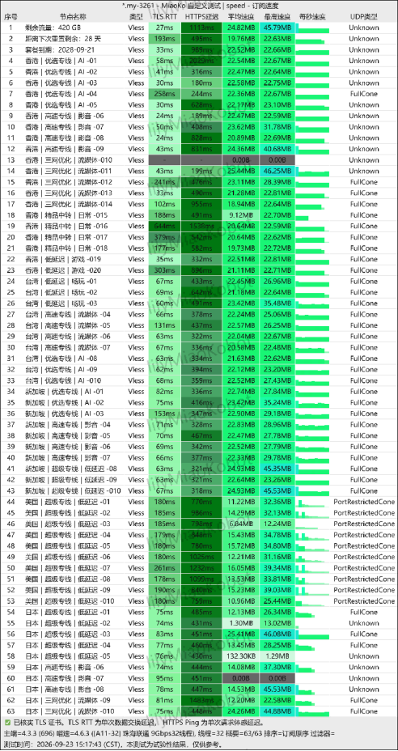

**榴莲云机场怎么样？** 榴莲云是一家运营资料约一年的订阅服务，定位是 **IEPL专线、低价小流量、年付和轻度使用**。品牌资料中的入门档为 **60GB/月，年付折合约5.6元/月**；常规套餐从140GB/月起，并提供支付宝、微信和USDT付款。新用户购买季付及以上套餐可使用优惠码 **`ll88`** 享7折。

综合来看榴莲云更适合网页、社交、AI工具和轻度视频，而不是只追求超大流量的用户。需要先说明：**5.6元是年付折算价，不是月付价**。

📣 <a href="https://t.me/LianyunPindao" target="_blank" rel="nofollow noopener">榴莲云 Telegram 官方频道</a>  
👥 <a href="https://t.me/+-_boXR6kHwAzMDZl" target="_blank" rel="nofollow noopener">榴莲云 Telegram 群组</a>  
📊 [返回2026年翻墙机场推荐评测主榜](/vpn-recommend/)  
🔎 [查看2026翻墙机场性能与价格对比榜](/airport/jichangpk/)  
ℹ️ [广告与联盟链接披露](/disclosure/)

<!-- more -->

---

## 一、榴莲云机场基础信息

| 项目 | 本次资料可确认的信息 |
| :--- | :--- |
| 品牌名称 | 榴莲云 |
| 官网入口 | [官网](https://yyovip01.liulianyunaff.com/#/?code=73XrVkC4) |
| 运营时间 | 1年 |
| 产品定位 | IEPL专线、低价小流量、年付、轻度用户 |
| 入门套餐 | 60GB/月，年付折合约5.6元/月 |
| 新客优惠 | 季付及以上7折，优惠码 `ll88` |
| 付款方式 | 支付宝、微信、USDT |
| 客户端 | 提供自研客户端；支持通用订阅和第三方客户端导入 |
| 协议信息 | 60个节点均显示VLESS |
| 节点地区 | 香港20个；台湾、新加坡、美国、日本各10个 |
| AI与流媒体 | 品牌资料称覆盖常见使用场景 |
| 官方联系 | [Telegram频道](https://t.me/LianyunPindao)、[Telegram群组](https://t.me/+-_boXR6kHwAzMDZl) |

## 二、榴莲云价格与7折优惠怎么算

### 1. 5.6元/月、60GB是什么价格

入门档 **“年付折合约5.6元/月，60GB”**。这表示用户需要一次支付一个较长周期，5.6元只是把年付金额平均到每个月，并不能按月支付5.6元。按月均价机械计算约为67.2元/年。

如果你只需要60GB左右流量，应先向客服确认四件事：该档是否仍在售、60GB是每月重置还是全年总量、可用节点是否与常规套餐相同、优惠码 `ll88` 能否继续叠加。

### 2. 四档常规套餐原价

| 套餐 | 每月流量 | 月付 | 季付 | 半年付 | 年付 | 两年付 |
| :--- | ---: | ---: | ---: | ---: | ---: | ---: |
| 轻享包 | 140GB | ¥24.00 | ¥64.80 | ¥122.40 | ¥230.40 | ¥403.20 |
| 畅享包 | 260GB | ¥40.00 | ¥108.00 | ¥204.00 | ¥384.00 | ¥672.00 |
| 尊享包 | 420GB | ¥60.00 | ¥162.00 | ¥306.00 | ¥576.00 | ¥1,008.00 |
| 搬迁王 | 750GB | ¥100.00 | ¥270.00 | ¥510.00 | ¥960.00 | ¥1,680.00 |

### 3. 使用ll88后的应付金额与月均成本

活动说明是“**新用户购买季付及以上套餐享7折**”，所以月付应先按原价看待。

| 套餐 | 月付原价 | 季付7折（月均） | 半年付7折（月均） | 年付7折（月均） | 两年付7折（月均） |
| :--- | ---: | ---: | ---: | ---: | ---: |
| 轻享包 140GB | ¥24.00 | ¥45.36（¥15.12） | ¥85.68（¥14.28） | ¥161.28（¥13.44） | ¥282.24（¥11.76） |
| 畅享包 260GB | ¥40.00 | ¥75.60（¥25.20） | ¥142.80（¥23.80） | ¥268.80（¥22.40） | ¥470.40（¥19.60） |
| 尊享包 420GB | ¥60.00 | ¥113.40（¥37.80） | ¥214.20（¥35.70） | ¥403.20（¥33.60） | ¥705.60（¥29.40） |
| 搬迁王 750GB | ¥100.00 | ¥189.00（¥63.00） | ¥357.00（¥59.50） | ¥672.00（¥56.00） | ¥1,176.00（¥49.00） |

折扣后的账面月均价会随预付周期降低，但这不代表两年付一定更划算。榴莲云一年，而两年付会把服务变化、线路调整和停止运营的风险延长到24个月。新用户更稳妥的顺序是：**先确认入门档或短周期能否购买，再测试季付；通过连续晚高峰验收后，才考虑年付。** 套餐周期的计算方法可参考[机场月付、季付和年付怎么选](/article/vpn-airport-monthly-vs-yearly-guide-2026/)。

> 优惠码：`ll88`。优惠资格、有效期、是否仅限首次订单、是否能与入门年付档叠加及续费价格，都应以结账页显示为准。

## 三、60个节点与地区分布

60个实际节点，另有3行剩余流量、到期时间和套餐信息。节点分布如下：

| 地区 | 节点数 | 截图中的用途标签 | 购买前应验证 |
| :--- | ---: | :--- | :--- |
| 香港 | 20 | AI、影视、流媒体、日常、游戏 | 本地三网延迟、晚高峰丢包和常用AI登录 |
| 台湾 | 10 | 低延迟、高速、流媒体、AI | 地区识别、视频平台片库和抖动 |
| 新加坡 | 10 | AI、影视、低延迟 | 东南亚服务访问和跨境延迟 |
| 美国 | 10 | 低延迟 | AI服务、美国流媒体和高延迟下的稳定性 |
| 日本 | 10 | 低延迟、影视、流媒体 | 游戏、视频和晚高峰拥堵情况 |

截图中60个节点的协议列均显示 **VLESS**。这能说明当次订阅样本使用VLESS，但品牌资料的协议字段没有统一说明，不能推断未来所有套餐、所有节点始终只使用这一协议。节点名称中的“AI”“影视”“低延迟”也是服务方标签，最终仍要用目标网站验证。

## 四、2026年9月23日测速图解读

所附 MiaoKo 截图的时间为 **2026年9月23日15:17:43（中国标准时间）**。除3行账户信息外，共有60个VLESS节点；其中58个显示非零下载结果，香港一条流媒体节点和日本一条影视节点显示0。截图里不少节点的下载读数在约22—45MB/s之间，但不同地区和节点差异明显，日本、美国部分节点更低。

这组数据可以回答“当时有多少节点返回测速结果”，却不能直接回答“榴莲云是不是最稳”：

1. 15:17不是通常拥堵更明显的20:00—23:00晚高峰；
2. 只有单一时间、单一网络环境，没有连续7天的连接成功率、丢包、抖动和断流记录；
3. MB/s是工具当次吞吐读数，不等于家庭宽带长期速度，也不能单凭峰值证明IEPL线路；
4. 两个0结果可能来自节点维护、测试异常或当时不可用，需要复测后才能归因；
5. 延迟和吞吐会受所在地、宽带运营商、路由、设备和测试目标影响。

建议购买后分别在家庭宽带和手机网络测试香港、日本、新加坡三个常用地区，并在工作日20:00—23:00连续记录至少3天。具体方法可参考[2026机场测速与晚高峰测试指南](/article/airport-speed-test-guide-2026/)。

## 五、IEPL专线意味着什么

榴莲云的核心卖点之一是 **IEPL专线**。IEPL通常用来描述跨境企业专线或专线型传输资源，相比纯公网直连，理论上更容易获得可控的跨境路径和晚高峰表现。但“IEPL”三个字本身不是速度保证，也不能由节点命名或一次测速独立证明。

判断线路是否符合预期，应结合不同运营商的路由追踪、晚高峰丢包、连续下载和故障切换表现。对于榴莲云，当前较稳妥的表述是“**品牌资料主打IEPL，所附测速显示多数节点当次返回非零结果，线路性质与长期稳定性仍需本地复测**”。线路概念可参考[直连、中转、BGP、IEPL与IPLC区别](/article/vpn-airport-route-types-guide-2026/)。

## 六、自研客户端、通用订阅与第三方导入

榴莲云同时提供 **自研客户端** 和 **通用订阅**。自研客户端适合希望少配置的新手；通用订阅则便于导入第三方客户端或保留自己的分流规则。不过当前资料没有列出订阅格式、支持版本和导入步骤，因此不能仅凭“支持通用订阅”就断言任意Clash分支、Shadowrocket、Stash、Surge、sing-box或v2rayN都能直接使用。

付款前建议向客服确认：

- Windows、macOS、Android和iOS分别推荐什么客户端；
- Clash Meta、Shadowrocket、sing-box等需要哪一种订阅格式；
- 通用订阅是否对所有套餐开放，还是需要客服手动生成；
- 同时在线设备、IP数量、连接数和流量倍率是否有限制；
- 订阅泄露后能否一键重置，设备迁移是否影响使用；
- 自研客户端下载地址、签名主体、更新渠道和隐私政策；
- 工单时段、退款条件和节点故障补偿规则。

## 七、AI工具与流媒体支持

覆盖常见AI工具和流媒体场景，但本次只收到速度测试，没有ChatGPT、Claude、Gemini、Netflix、Disney+或其他平台的独立解锁截图。因此本文把这些能力记为 **“服务方宣称支持，实际待测”**，不写成全节点解锁或长期保证。

AI工具可用性不仅取决于能否连接，还会受到出口IP信誉、账号注册地区、支付方式和平台风控影响；流媒体也可能只解锁部分节点或特定地区片库。主要用途是AI或视频时，应逐项测试登录、对话、图片上传、视频播放、清晰度和持续缓冲情况，并准备至少两个不同地区节点。

## 八、支付方式与隐私注意事项

榴莲云支持支付宝、微信和USDT。支付宝与微信操作门槛低，但交易记录与实名账户关联；USDT不等于完全匿名，链上转账公开可追踪，还需要核对网络类型、地址和手续费。无论使用哪种方式，都应先确认收款对象、订单自动入账方式和退款原路。

不要在Telegram群公开发送订阅链接、订单截图、交易哈希、邮箱或设备信息。订阅链接相当于访问凭证，一旦泄露应立即在用户中心重置或联系客服处理。更完整的风险说明见[机场订阅链接泄露检测与重置指南](/article/airport-subscription-security-guide-2026/)。

## 九、榴莲云优缺点总结

### 优点

- 60GB年付档折合约5.6元/月，面向低预算、低流量用户；
- 常规套餐从140GB到750GB，流量梯度比较完整；
- 新用户季付及以上使用 `ll88` 可按资料享7折；
- 品牌资料主打IEPL，截图覆盖香港、台湾、新加坡、美国、日本60个节点；
- 同时提供自研客户端与通用订阅；
- 支持支付宝、微信和USDT，付款选择较多。

### 风险与待核验项

- 运营一年，长期稳定性和服务主体仍需时间验证；
- 5.6元档没有给出年付总价、购买页和完整条款；
- 月付七折计算与“季付及以上才享7折”的规则冲突，必须以结账页为准；
- IEPL、AI和流媒体能力来自品牌资料，未完成独立验证；
- 只有一次下午测速，不能证明晚高峰或长期稳定；
- 未提供官网、退款规则、设备限制、倍率和第三方客户端清单；
- 两年付折算更低，但预付周期长于当前运营资料时间，风险偏高。

## 十、榴莲云适合哪些用户

**比较适合：** 每月60—140GB左右即可满足网页、社交、AI和轻度视频需求，预算有限，接受年付折算方式，并愿意在购买前通过Telegram核对入口与规则的用户。需要五个常用地区、希望同时保留自研客户端和第三方订阅选择的人，也可以把它放进候选清单。

**不建议直接长付：** 把网络用于生产业务、远程会议或直播，要求明确退款SLA、固定原生IP、特定流媒体长期解锁，或者无法接受服务变化的用户。两年付虽然月均最低，但新用户不应只为折扣直接预付24个月。

首次购买建议优先顺序是：确认官方入口与60GB档总价 → 核对 `ll88` 的结账金额 → 确认第三方客户端格式 → 选择最短可用周期 → 按[机场试用验收表](/article/vpn-airport-trial-checklist-2026/)测试晚高峰、目标应用和流量扣量 → 再决定是否续费或升级。

## 十一、榴莲云机场常见问题

### 榴莲云机场最低多少钱？

60GB/月的年付入门档折合约 **5.6元/月**，但没有给出年付总价。它不是5.6元月付套餐，实际一次支付金额、流量重置方式和在售状态应向客服确认。

### 榴莲云优惠码ll88怎么用？

新用户购买季付及以上套餐时输入 **`ll88`**，资料称可享7折。是否限首单、何时到期、能否用于60GB年付档或续费，以结账页显示为准；月付按当前活动文字不在优惠范围内。

### 榴莲云有多少节点？

60个实际节点：香港20个，台湾、新加坡、美国、日本各10个。节点数量和地区会随维护变化，应以购买后订阅为准。

### 榴莲云使用什么协议？

品牌规格没有统一提供协议清单，但本次测速截图里的60个节点都标为 **VLESS**。这只代表当次订阅样本，未来协议和订阅格式应以客户端或客服说明为准。

### 榴莲云支持Clash和Shadowrocket吗？

资料确认支持通用订阅和第三方客户端导入，但没有明确列出Clash、Shadowrocket及版本范围。付款前应让客服确认对应订阅格式和导入步骤，不要只看“通用订阅”四个字。

### 榴莲云能用ChatGPT、Claude、Gemini或Netflix吗？

覆盖常见AI和流媒体场景，但没有提供独立解锁检测。平台规则和IP状态会变化，建议购买后测试自己的账号、目标地区和常用节点。

### 榴莲云晚高峰稳定吗？

现有测速发生在15:17左右，不是晚高峰。应在自己的运营商网络连续测试多个工作日20:00—23:00，才能判断是否适合长期使用。

### 榴莲云可以直接买两年吗？

技术上套餐表提供两年付，且7折后月均价最低；但品牌一年，两年预付周期更长。新用户更适合先测试短周期，再按真实稳定性而不是折扣幅度决定。

## 总结：榴莲云值得买吗？

榴莲云的差异化比较清晰：**IEPL定位、60GB年付约5.6元/月、季付及以上7折、五地60个VLESS测速节点，以及自研客户端加通用订阅**。它适合低流量、低预算的轻度用户加入候选名单，但现有材料不足以证明长期晚高峰稳定，也没有完整官网、退款、设备和解锁资料。

因此更稳妥的结论不是“最便宜就直接年付”，而是先从官方频道确认入口，用 `ll88` 核对真实结账金额和优惠范围，再以最短可行周期测试客户端、常用节点、AI或流媒体任务。通过连续晚高峰验收后，再考虑年付；不建议新用户一开始购买两年付。

> 资料说明：价格、活动、运营时间、IEPL、AI与流媒体支持均核实过；请以当前购买页与客服书面答复为准，并遵守所在地法律法规及相关平台服务条款。

## 更新记录

- **2026-10-10：** 首次发布，整理60GB年付入门档、四类常规套餐、优惠码 `ll88`、60节点测速、客户端兼容和风险边界。
