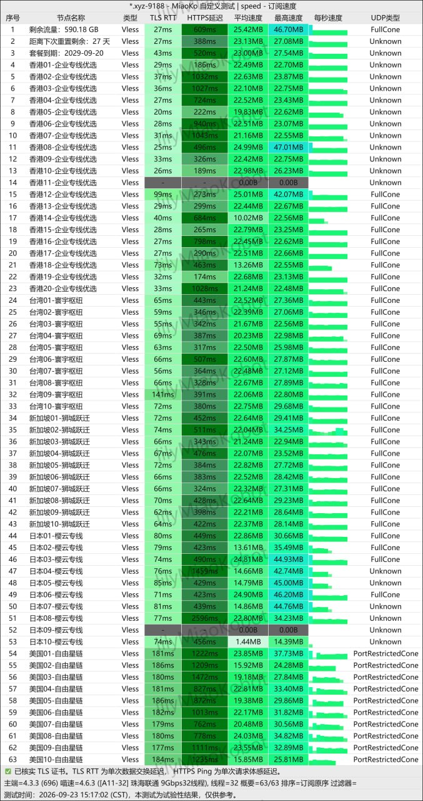
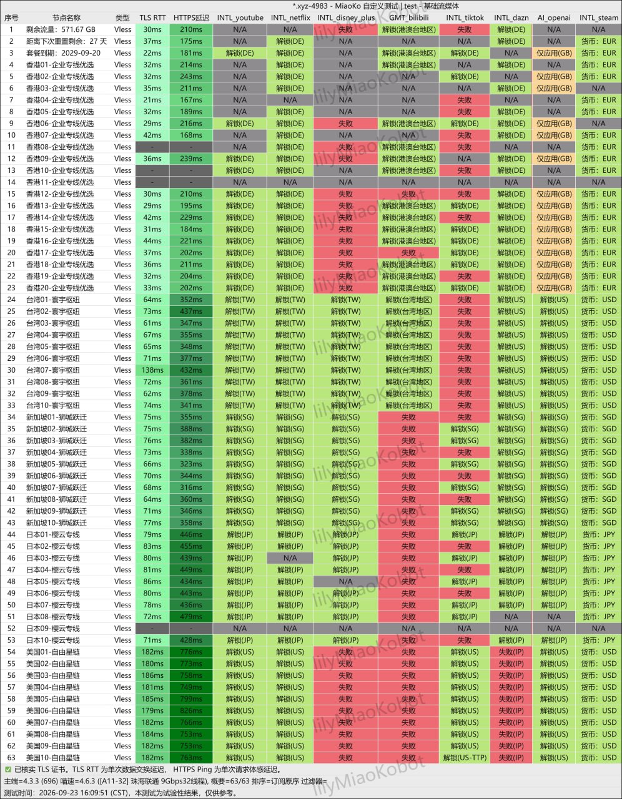

**环球梯机场怎么样？** 环球梯是一家以 **VLESS协议、纯专线宣传、3—10台设备、60GB—600GB月流量** 为主要卖点的订阅服务。套餐覆盖年付、月付和一次性流量包，最低长期档为 **96元/年、60GB/月**，折合8元/月；最低月付档是 **22元/月、120GB**。活动码为 **7折优惠码 `HQ66`**。

本次资料还包含两张 **2026年9月23日** 的MiaoKo测试截图：速度测试列出香港、台湾、新加坡、日本、美国共60个VLESS节点，58个返回非零读数；随后进行的流媒体与AI检测显示，各地区对Netflix、Disney+、TikTok、DAZN和OpenAI的结果有明显差异。截图发生在15:17和16:09，属于日间单次样本，不能当作晚高峰或长期稳定性保证。

📲 <a href="https://ghjds.huanqiuityu.xyz/#/?code=HdrabWkD" target="_blank" rel="sponsored nofollow noopener">环球梯官网入口</a>（提交的显示域名：a01vipaff.huanqiutiaff.com）  
🎟️ **7折优惠码：`HQ66`**（适用套餐、有效期及续费规则以结账页为准）  
📣 <a href="https://t.me/huanqiuti88" target="_blank" rel="nofollow noopener">环球梯 Telegram 群或频道</a>  
📊 [返回2026年翻墙机场推荐评测主榜](/vpn-recommend/)  
🔎 [查看2026翻墙机场性能与价格对比榜](/airport/jichangpk/)  
ℹ️ [广告与联盟链接披露](/disclosure/)

<!-- more -->

---

## 一、环球梯机场基础信息

| 项目 | 本次资料可确认的信息 |
| :--- | :--- |
| 品牌名称 | 环球梯 / 环球梯机场 |
| 访问入口 | [官网](https://ghjds.huanqiuityu.xyz/#/?code=HdrabWkD) |
| 优惠码 | `HQ66`，资料称7折 |
| 最低长期套餐 | 96元/年、60GB/月，折合8元/月 |
| 最低月付套餐 | 环球轻享22元/月、120GB |
| 协议 | 本次60个测速节点均标为VLESS |
| 线路 | 全线“纯专线” |
| 节点地区 | 香港20个；台湾、新加坡、日本、美国各10个 |
| 设备限制 | 依套餐为3、5、8或10台 |
| 一次性套餐 | 99元80GB、299元400GB |
| 付款方式 | 支付宝、微信 |
| Telegram | [t.me/huanqiuti88](https://t.me/huanqiuti88) |

## 二、环球梯套餐价格与设备限制

### 周期套餐原价

| 套餐 | 设备限制 | 每月流量 | 月付 | 季付 | 半年付 | 年付 | 两年付 | 三年付 | 重置包 |
| :--- | ---: | ---: | ---: | ---: | ---: | ---: | ---: | ---: | ---: |
| 环球学生套餐 | 3台 | 60GB | — | — | — | ¥96 | — | — | ¥96 |
| 环球轻享 | 3台 | 120GB | ¥22 | ¥65 | ¥126 | ¥227 | ¥407 | ¥558 | ¥22 |
| 环球畅游 | 5台 | 240GB | ¥39 | ¥111 | ¥210 | ¥378 | ¥678 | ¥918 | ¥39 |
| 环球尊享 | 10台 | 600GB | ¥69 | ¥198 | ¥378 | ¥678 | ¥1,218 | ¥1,668 | ¥69 |

套餐明细又写“环球学生套餐60G、年付96元”。本文按完整套餐区间把学生档整理为 **60GB/月、年付96元**，但购买前必须在结账页确认它究竟是“每月重置60GB”还是“全年共享60GB”。两者一年可用流量相差12倍，不能只看“折合8元/月”。

“重置包”通常是当期流量提前用完后重新获得额度，不应自动理解为延长套餐有效期。环球学生套餐的重置包价格与年费同为96元，是否值得购买尤其需要向客服确认重置后的流量、有效期和次数规则。

### 长周期的账面月均成本

| 套餐 | 月付 | 年付月均 | 两年付月均 | 三年付月均 |
| :--- | ---: | ---: | ---: | ---: |
| 环球学生套餐 | 无月付 | ¥8.00 | — | — |
| 环球轻享120GB | ¥22.00 | 约¥18.92 | 约¥16.96 | ¥15.50 |
| 环球畅游240GB | ¥39.00 | ¥31.50 | ¥28.25 | ¥25.50 |
| 环球尊享600GB | ¥69.00 | ¥56.50 | ¥50.75 | 约¥46.33 |

三年付的月均价最低，但预付时间越长，域名变化、线路调整、售后变化与停止运营造成的损失越大。新用户更适合先用月付验证，不建议仅为最低月均价直接锁定两年或三年。

## 三、7折优惠码HQ66怎么核价

资料提供的优惠是 **7折优惠码 `HQ66`**。中文促销中的“7折”通常表示支付原价的70%，不是只减7%。在结账页确认目标套餐确实参与活动的前提下，理论价格如下：

| 原价示例 | 理论7折价 | 购买前要确认 |
| :--- | ---: | :--- |
| 学生套餐¥96/年 | ¥67.20/年 | 特价年付档是否排除优惠码 |
| 轻享¥22/月 | ¥15.40/月 | 月付是否参与 |
| 轻享¥227/年 | ¥158.90/年 | 续费是否同价 |
| 畅游¥39/月 | ¥27.30/月 | 是否限首单或新用户 |
| 畅游¥378/年 | ¥264.60/年 | 能否与年付价叠加 |
| 尊享¥69/月 | ¥48.30/月 | 600GB是否有倍率或限速 |
| 尊享¥678/年 | ¥474.60/年 | 续费、退款与设备规则 |

## 四、一次性流量包值不值

| 套餐 | 设备限制 | 一次性价格 | 总流量 | 名义每GB成本 | 更适合 |
| :--- | ---: | ---: | ---: | ---: | :--- |
| 环球随行包 | 5台 | ¥99 | 80GB | 约¥1.238/GB | 极低频、临时备用 |
| 环球灵活包 | 8台 | ¥299 | 400GB | 约¥0.748/GB | 低频长期使用、多人轻量共享 |

环球灵活包的名义每GB成本比环球随行包低约39.6%，但需要多付200元。这里的“一次性”通常是一次购买一池流量，不按月续费；它不自动等于服务永久存在、账号永不过期或流量永不回收。购买前应确认账号有效期、长期不登录规则、节点是否与周期套餐相同、流量倍率、设备/IP限制，以及服务停止后的处理方式。可结合[一次性流量包价格计算与避坑教程](/article/one-time-data-vpn-airport-guide-2026/)判断。

## 五、VLESS、纯专线与60个节点怎么理解

速度截图前3行是账户剩余流量、下次重置和套餐到期信息，不是节点；实际节点从第4行开始，共60个：

| 地区 | 节点数 | 截图中的节点标签 | 需要本地复测的重点 |
| :--- | ---: | :--- | :--- |
| 香港 | 20 | 企业专线优选 | 三网入口、晚高峰抖动、AI出口信誉 |
| 台湾 | 10 | 寰宇枢纽 | 地区识别、流媒体片库、丢包与延迟 |
| 新加坡 | 10 | 狮城跃迁 | 东南亚服务、AI工具和长连接 |
| 日本 | 10 | 樱云专线 | 低读数节点、游戏延迟与视频拖动 |
| 美国 | 10 | 自由星链 | 跨洋延迟、OpenAI与美国流媒体 |

60个节点的“类型”栏均标为 **VLESS**，这能确认测试样本所用协议；但 **VLESS是协议，不等于专线**。“纯专线”“企业专线优选”等来自服务方描述与节点名称，截图没有路由追踪、入口出口链路或运营商信息，无法独立证明IEPL、IPLC或其他具体专线类型。线路选择可参考[直连、中转、BGP、IEPL与IPLC区别教程](/article/vpn-airport-route-types-guide-2026/)。

## 六、2026年9月23日速度截图解读

速度截图底部标注测试时间为 **2026年9月23日15:17:02（CST）**，工具为MiaoKo 4.3.3 (696)，环境标注“珠海联通9Gbps、32线程”。按截图逐行整理：

| 地区 | 非零节点 | 截图“平均速度”范围 | 当次观察 |
| :--- | ---: | :--- | :--- |
| 香港 | 19/20 | 非零约10.02—25.01MB | 香港11为0，其余19个有非零读数 |
| 台湾 | 10/10 | 约20.23—23.09MB | 全部非零，读数较集中 |
| 新加坡 | 10/10 | 约21.24—22.82MB | 全部非零，读数较集中 |
| 日本 | 9/10 | 非零约1.44—24.90MB | 日本09为0，地区内差异较大 |
| 美国 | 10/10 | 约15.85—23.85MB | 全部非零；TLS RTT约177—186ms |

总计 **58/60个实际节点返回非零平均速度，单次非零率约96.7%**。台湾、新加坡的截图读数相对集中；香港和日本各有一个0值，日本10号的非零读数也明显低于该地区大部分节点。美国跨洋TLS RTT更高符合距离特征，但HTTPS延迟、真实应用首包与长连接体验仍要在用户自己的网络里验证。

### 这张速度图能证明什么

- 能确认该订阅样本当时列出五地60个VLESS节点；
- 能说明该次珠海联通、高带宽、32线程环境中58个节点返回非零读数；
- 能作为五个地区在同一时刻、同一测试环境下的横向样本；
- 能暴露香港11、日本09为0和日本地区内部差异，而不是只展示最快节点。

### 这张速度图不能证明什么

- 15:17的日间测试不能证明20:00—23:00晚高峰仍能跑满4K/8K；
- 单次96.7%非零率不能推导7天、30天在线率或“敏感时期抗封锁”；
- 9Gbps、32线程环境的MB读数不能直接承诺普通家庭宽带的单连接速度；
- 节点名不能独立证明线路一定是纯专线；
- UDP类型不等于游戏一定低延迟，也不代表所有网络的NAT表现相同。

建议购买后固定香港、台湾、新加坡、美国各1—2个节点，在家庭宽带和手机网络分别连续测试至少3个工作日的20:00—23:00时段。记录连接成功率、丢包、抖动、网页首开、视频拖动与长连接断线，完整方法见[机场速度、延迟、丢包与晚高峰测试教程](/article/airport-speed-test-guide-2026/)。

## 七、Netflix、Disney+、OpenAI与TikTok解锁实测

第二张截图标注时间为 **2026年9月23日16:09:51（CST）**，对同一批60个VLESS节点检测YouTube、Netflix、Disney+、哔哩哔哩、TikTok、DAZN、OpenAI和Steam。截图显示的核心结论不是“所有节点全解锁”，而是 **解锁能力明显依赖地区和具体节点**：

| 项目 | 截图可见结果 | 如何理解 |
| :--- | :--- | :--- |
| YouTube | 台湾、新加坡、日本、美国多显示对应地区；香港有N/A及德国结果 | 地区识别不完全等于账号或内容长期可用 |
| Netflix | 多数可见地区解锁，常见为DE、TW、SG、JP、US；仍有N/A | 正向样本较多，但应登录并搜索非自制内容复测 |
| Disney+ | 台湾、新加坡、日本有较多地区结果；香港混有失败/N/A，美国节点截图多为失败 | 与“全解锁Disney+”宣传不完全一致 |
| 哔哩哔哩 | 香港、台湾部分节点显示港澳台地区；新加坡、日本、美国多为失败 | 地域内容应按目标片库选节点 |
| TikTok | 香港、台湾存在大量失败；新加坡、日本结果混合；美国多显示US | 不能承诺所有地区或全部节点可用 |
| DAZN | 香港、台湾、新加坡、日本多显示地区结果；美国多为“失败(IP)” | IP信誉和平台策略影响明显 |
| OpenAI | 台湾、新加坡、日本、美国多显示对应地区；香港部分为“仅应用(GB)”或N/A | 不能把单次检测等同于ChatGPT网页、API和账号均长期稳定 |
| Steam | 常见货币为EUR、USD、SGD、JPY，另有N/A | 可辅助判断出口地区，但不是支付区服保证 |

服务方广告称可解锁Netflix、Disney+和ChatGPT等AI服务；测试截图为这一主张提供了部分正向样本，也同时显示失败、N/A和“仅应用”。更准确的结论是：**部分地区和节点具备解锁能力，但“全解锁”并未被这组截图完整证实。**

AI工具除了出口地区，还受IP信誉、账号地区、手机号、支付方式和平台风控影响；流媒体检测显示“解锁”也不等于可以登录、看到目标片库并持续4K播放。短期验收至少应包含登录、连续对话或上传、搜索地区独占内容、播放20分钟和晚高峰拖动进度条。

## 八、不支持通用订阅意味着什么

提交资料明确写明 **不支持通用订阅**。这与很多可直接复制订阅链接到Clash Verge、Shadowrocket、Stash、sing-box或v2rayN的机场不同，也是购买前最需要确认的一项限制。

不支持通用订阅可能意味着只提供官方客户端、只支持指定系统，或节点需要用特定方式导入。现有资料没有列出客户端名称、支持平台和下载来源，因此本文不会仅凭“VLESS”就推断它一定支持任意VLESS客户端。付款前应向客服逐项确认：

1. Windows、macOS、Android、iOS和路由器分别支持什么客户端；
2. iPhone是否需要额外购买应用或使用海外Apple ID；
3. 官方客户端的下载域名、签名主体、更新渠道与杀毒误报处理；
4. 3—10台设备限制按安装数、同时在线设备数、在线IP数还是连接数计算；
5. 换机、重装系统、家庭共享和设备解绑如何处理；
6. 是否完全不能提供Clash、Shadowrocket、sing-box或v2rayN格式。

如果你必须使用自选客户端、路由器分流或已有规则集，应把“无通用订阅”视为重要兼容性门槛，而不是付款后再解决的小问题。多设备规则可参考[一个机场可以几台设备：家庭共享教程](/article/vpn-airport-device-limit-family-sharing-guide-2026/)。

## 九、环球梯的优点与购买风险

### 现有的优点

- 96元年付60GB，按月流量口径折合8元/月，轻量档门槛较低；
- 22元120GB、39元240GB、69元600GB三档月付，覆盖轻量到高流量；
- 设备限制随套餐从3台提升到10台，适合个人与家庭选择；
- 提供99元80GB和299元400GB两档一次性流量包；
- 优惠码 `HQ66` 的宣传折扣为7折，若目标套餐可用，降价幅度明显；
- 两张截图覆盖五地60个VLESS节点，既包含速度也包含流媒体和OpenAI检测；
- 支持支付宝和微信，付款方式对国内用户较方便。

### 购买前必须核验

- `HQ66` 的有效期、适用套餐、首购/续费与叠加规则未说明；
- 不支持通用订阅，第三方客户端和路由器用户存在明显兼容风险；
- “纯专线”“晚高峰跑满4K/8K”“抗封锁”属于服务方宣传，截图不能独立验证；
- 测速发生在下午，不是晚高峰，也没有连续多日丢包、抖动和断流记录；
- 解锁截图存在失败、N/A和“仅应用”，与“全解锁”不能画等号；
- 显示域名与实际落地域名不同，付款前需要再次核验入口。

## 十、环球梯适合哪些用户

**可以加入短测清单：** 每月120—240GB，使用香港、台湾、新加坡、日本或美国节点，愿意先月付验证速度、目标平台和客户端的个人用户。22元轻享档是比年付更稳妥的首次验收入口；若 `HQ66` 确认适用于月付，理论实付还会降低。

**轻量年付候选：** 每月60GB足够、已确认学生套餐按月重置，并在目标设备完成短期测试的用户。8元是96元年付的折算月均，不是8元月付。

**家庭或高流量用户：** 240GB/5台和600GB/10台提供了更高流量与设备数，但必须先问清“设备”究竟如何计数。家庭共享还要考虑同时看视频时的带宽、在线IP限制与流量消耗。

**低频备用：** 80GB与400GB一次性流量包适合偶尔使用或备用；长期备用前要确认账号与流量不会因不活跃被回收。

**不太适合：** 必须使用Clash、Shadowrocket、自建规则或路由器透明代理，但客服不能提供兼容方式的用户；以及需要固定IP、企业SLA、直播推流或生产环境长期保证的用户。

## 十一、购买前检查清单

1. 通过Telegram或客服复核显示域名、实际落地域名、品牌与收款信息；
2. 确认学生套餐的60GB是每月重置还是全年总量；
3. 在结账页输入 `HQ66`，核对实付、适用周期、续费价和活动期限；
4. 先说明自己的系统和客户端需求，确认无通用订阅情况下能否正常使用；
5. 问清设备/IP/连接限制、流量倍率、限速、重置包和一次性流量有效期；
6. 优先购买22元月付或其他最短周期，连续测试晚高峰和自己的AI、流媒体任务；
7. 通过[统一机场试用验收表](/article/vpn-airport-trial-checklist-2026/)后再考虑年付，并准备独立运营主体的备用服务。

## 十二、环球梯机场常见问题

### 环球梯机场官网是什么？

[官网](https://ghjds.huanqiuityu.xyz/#/?code=HdrabWkD)，含推广参数。本站检查时可访问，但机场入口可能变化，付款前应通过[Telegram群或频道](https://t.me/huanqiuti88)或客服再次核对。

### 环球梯优惠码HQ66怎么用？

在结账页输入 **`HQ66`**，资料称可享7折。看到订单金额实际变为原价的70%左右后再付款；学生套餐、一次性包、重置包与续费能否使用，都以结账页为准。

### 环球梯最低多少钱？

最低长期档是 **96元/年、60GB/月**，折合8元/月，但需要一次支付年费。最低可月付档是环球轻享 **22元/月、120GB**。

### 环球梯有多少节点？

60个实际节点：香港20个，台湾、新加坡、日本、美国各10个，协议栏均标为VLESS。服务方宣传为60+节点，节点数量会随维护变化，以用户当前客户端内可见列表为准。

### 环球梯支持Clash和Shadowrocket吗？

资料明确写“不支持通用订阅”，所以不能默认可直接导入Clash或Shadowrocket。购买前应向客服报出设备、系统、客户端和版本，取得明确的兼容答复。

### 环球梯有一次性套餐吗？

有，环球随行包99元80GB、环球灵活包299元400GB。一次性购买不等于服务永久有效，需要确认账号回收、流量有效期、节点范围和倍率。

### 环球梯速度稳定吗？

15:17的单次测试中58/60个实际节点返回非零读数，是一组日间正向样本；它不能证明晚高峰或长期稳定。用户所在地、运营商、设备和目标应用都不同，应连续多个工作日晚高峰复测。

### 环球梯能用Netflix、Disney+和ChatGPT吗？

服务方主打流媒体和AI，Netflix有较多正向地区结果，Disney+、TikTok、DAZN和OpenAI也出现失败、N/A或“仅应用”。应以短期套餐在自己的账号、节点和网络中测试，不能只看“全解锁”广告词。

## 总结：环球梯值得买吗？

环球梯的核心配置是 **96元年付60GB、22元月付120GB、7折优惠码 `HQ66`、两档一次性流量、3—10台设备，以及五地60个VLESS节点**。58个节点返回非零读数，台湾和新加坡当次结果较集中；香港和日本各有一个0值。解锁图既有Netflix、OpenAI等正向地区结果，也有Disney+、TikTok、DAZN的失败及N/A，说明它更适合按实际任务试用，而不是依据“全解锁”直接长付。

更稳妥的购买顺序是：先核对入口与60GB重置口径，再确认无通用订阅时的设备兼容方式，在结账页验证 `HQ66` 的真实折扣，最后用22元月付或最短周期完成晚高峰、AI和流媒体验收。只有连续测试符合需求后，96元年付才具有实际性价比；两年、三年付不应只因月均价更低就直接购买。

> 资料说明：套餐、设备、支付、协议、线路与解锁定位；速度与平台结论按2026年9月23日两张MiaoKo截图整理；入口可达性于2026年10月10日核验。访问入口含推广参数，商业关系见[披露页](/disclosure/)。价格、活动、节点和平台策略会变化，请以当前结账页、客户端与客服书面答复为准，并遵守所在地法律法规及相关平台服务条款。

## 更新记录

- **2026-10-10：** 首次发布，整理全部周期套餐、一次性流量、`HQ66`优惠码、设备限制、60个VLESS节点速度与流媒体/OpenAI检测边界。
