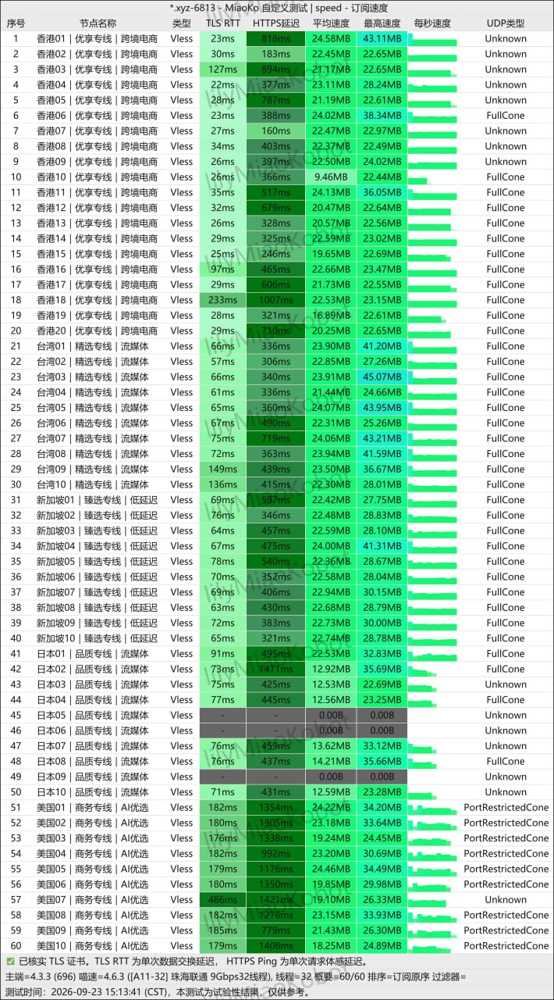
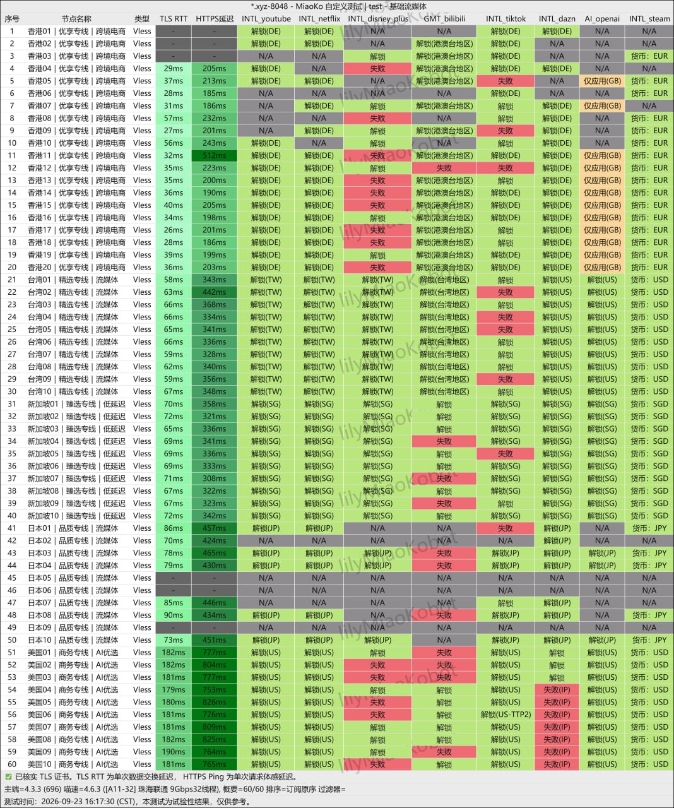
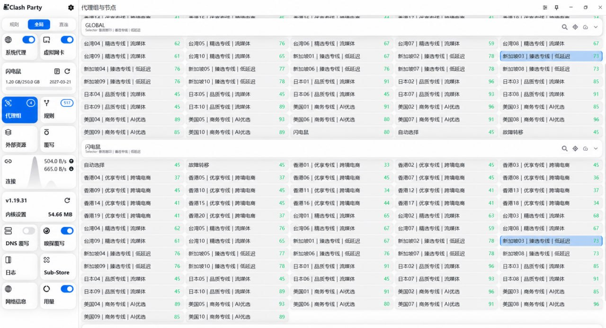

**闪电鼠机场怎么样？闪电鼠靠谱吗？** 截至 **2026年10月11日**，闪电鼠是一家自述由新加坡海外团队运营、主打 **VLESS协议、IPLC/IEPL专线、不限设备和AI/流媒体解锁** 的机场服务。提交的运营起始日期为 **2024年3月8日**，到本次更新约为2年7个月。

先说结论：闪电鼠的入门长期档是 **96元/年、60GB/每30天**，折合8元/月；可直接月付的入门档是 **19.9元100GB**。用户提供的2026年9月23日日间单次截图覆盖五地60个VLESS节点，其中 **57/60有非零吞吐，包含零值的整体平均约20.06MB/s**。这是一组积极的可达性与吞吐样本，但不是晚高峰或长期在线率证明。同时，通用订阅与一次性套餐都标注为“后期开放”，对必须使用Clash、Shadowrocket、sing-box或v2rayN的用户是当前最需先核对的限制。

📲 <a href="https://yyo64.shandianshuaff.com/#/?code=wX9muuTQ" target="_blank" rel="sponsored nofollow noopener">闪电鼠官网线路检测入口</a>  
📊 [返回2026年翻墙机场推荐主榜](/vpn-recommend/)  
🔎 [查看2026翻墙机场性能与价格对比榜](/airport/jichangpk/)  
ℹ️ [广告与联盟链接披露](/disclosure/)

<!-- more -->

---

## 一、闪电鼠机场基本信息

| 项目 | 截至2026年10月11日可确认的信息 |
| :--- | :--- |
| 品牌 | 闪电鼠 / 闪电鼠机场 |
| 官网入口 | [官网](https://yyo64.shandianshuaff.com/#/?code=wX9muuTQ) |
| 运营起始 | 2024年3月8日（由服务方提供） |
| 团队与定位 | 新加坡海外团队、大机房、便宜/稳定/高品质 |
| 最低长期价 | ¥96/年，60GB/每30天，折合¥8/月 |
| 最低月付 | ¥19.90/月，100GB/每30天 |
| 月付流量 | 100GB、150GB、250GB、500GB |
| 节点与协议 | 60个VLESS节点；港20，台/日/新/美各10 |
| 线路宣传 | 套餐卡分别标注IPLC或IEPL专线，单节点峰值最高2.5Gbps |
| 设备与倍率 | 套餐页标注不限设备、不限速；多个月付档标注全节点×1倍率 |
| 通用订阅 | 计划后期开放，当前格式与获取方式需客服确认 |
| 一次性套餐 | 计划后期开放，当前不记为可购买 |
| 客服与保障 | 宣传24小时客服、不满意退款、故障1小时内修复；条款和样本待核验 |

线路检测页的公共配置返回品牌名“闪电鼠”，并在多个备用域名间检测和跳转。这可以降低单一入口临时不可用的影响，但备用域名仍可能变化；不要只根据搜索结果中的同名站点付款。

## 二、闪电鼠套餐价格完整对比

| 套餐 | 价格与周期 | 流量 | 页面标注 | 名义流量单价 | 适合场景 |
| :--- | ---: | ---: | :--- | ---: | :--- |
| 限时钜惠小包 | ¥96/年 | 60GB/每30天 | IPLC专线、不限设备、不限速 | ¥0.133/GB | 轻量长期、低预算备用 |
| 闪电鼠·性价版 | ¥19.90/月 | 100GB/每30天 | 智能调度、不限设备、不限速 | ¥0.199/GB | 首次月付验收 |
| 闪电鼠·轻快版 | ¥25/月 | 150GB/每30天 | IEPL专线、×1倍率、不限设备 | ¥0.167/GB | 日常视频与AI工具 |
| 闪电鼠·疾速版 | ¥40/月 | 250GB/每30天 | IEPL专线、智能路由、×1倍率 | ¥0.160/GB | 中高流量、多终端 |
| 闪电鼠·雷霆版 | ¥70/月 | 500GB/每30天 | IEPL专线、高峰容量宣传、×1倍率 | ¥0.140/GB | 确有大流量需求的用户 |

### 96元年付为什么是8元月均，却不是8元月付

96元除以12个月等于8元/月，但用户需要一次支付全年费用。套餐页写明“购买日起算，每30天自动刷新流量”，因此60GB可按每30天重置记录，但付款前仍应确认：

1. 首次重置日是否严格按购买时间计算；
2. 未用完流量是否清零；
3. 升级套餐后到期日和重置日怎么变；
4. 续费时是否仍为96元；
5. 年付用户是否适用宣传中的退款保障。

对第一次使用闪电鼠的用户，**19.9元月付虽然月均成本更高，但总投入更低、退出成本也更低**。先月付验收再决定是否年付，通常比只比“折合月价”更稳妥。

## 三、VLESS协议、IPLC/IEPL专线怎么理解

60个节点均标为 **VLESS**。VLESS是节点协议层信息，不能单独证明线路一定是IPLC或IEPL；套餐页则在不同档位标注了IPLC或IEPL专线、单节点峰值最高2.5Gbps等宣传。

这些参数需要分开理解：

- **VLESS** 是代理协议，不等于专线类型；
- **IPLC/IEPL** 是服务方对传输线路的标注，不同套餐未必使用完全相同的路径；
- **2.5Gbps** 是页面宣称的单节点峰值，不是单用户持续可用带宽保证；
- **不限速** 表示套餐卡没有列出固定Mbps上限，不代表节点没有负载或公平使用策略；
- **纯专线** 是本次服务方提供的定位说明，没有独立路由证据用于核验所有节点。

真正决定体验的是用户所在地、电信/联通/移动入口、Wi-Fi和设备性能、节点负载、跨境路由以及测试时段。可按[机场测速完整教程](/article/airport-speed-test-guide-2026/)在自己的网络下做连续7天同条件记录。

## 四、60个VLESS节点速度实测解读

MiaoKo记录于 **2026年9月23日15:13:41（CST）**，后端标注为 **珠海联通9Gbps、32线程**。因为15:13不属于通常意义上的19:00—23:00晚高峰，本文只将其记为 **日间高并发远端单次样本**。

| 地区 | 节点数 | 非零节点 | 地区平均速度 | 非零节点范围 | TLS RTT中位数 | HTTPS延迟中位数 |
| :--- | ---: | ---: | ---: | ---: | ---: | ---: |
| 香港 | 20 | 20/20 | 21.34MB/s | 9.46—24.58MB/s | 28.5ms | 400ms |
| 台湾 | 10 | 10/10 | 23.23MB/s | 21.44—24.07MB/s | 66.5ms | 361.5ms |
| 新加坡 | 10 | 10/10 | 22.75MB/s | 22.36—24.00MB/s | 69ms | 418ms |
| 日本 | 10 | 7/10 | 10.10MB/s（含3个零值） | 12.53—22.53MB/s | 76ms* | 459ms* |
| 美国 | 10 | 10/10 | 21.61MB/s | 18.25—24.46MB/s | 181ms | 1321.5ms |
| **总计** | **60** | **57/60** | **20.06MB/s（含零值）** | **9.46—24.58MB/s** | **69ms*** | **445ms*** |

\* 延迟统计只使用57个有读数的节点。TLS RTT是单次TLS握手延迟，HTTPS Ping是单次请求体感延迟，二者不等于游戏中的ICMP Ping。

60个节点的“平均速度”含零值均值约 **20.06MB/s**，57个非零节点的均值约 **21.12MB/s**。最高平均速度为香港01的24.58MB/s，最高“最大速度”读数为台湾03的45.07MB/s；日本05、06、09为0。截图列名显示单位为“MB”，本文根据速度语义记为MB/s；理论上1MB/s约等于8Mbps。

### 这组测速能证明什么

- 在珠海联通9Gbps后端的这一次测试中，60个节点有57个返回非零吞吐；
- 香港、台湾、新加坡和美国组当时均为全节点非零；
- 台湾组平均速度约23.23MB/s，为五地最高；
- 日本组有3个零速节点，显示同一地区内也需要保留多个备选；
- 另一张Clash Party截图中可见节点延迟多为绿色读数，但缺少时间、网络和测试方法，只能用作当次可达性参考。

### 这组测速不能证明什么

- 不能证明中国各地电信、联通、移动或校园网都会获得相同速度；
- 不能证明晚高峰仍能跑满4K/8K，因为截图时间是15:13；
- 不能证明后端9Gbps等于单个用户或单节点的持续带宽；
- 没有连续多日丢包、抖动、断流、上传、复活时间和在线率数据；
- 不能独立证明全节点均为IPLC/IEPL或长期全平台解锁。

## 五、ChatGPT与流媒体解锁实测怎么样

解锁检测记录于 **2026年9月23日16:17:30（CST）**，列出Netflix、YouTube、Disney+、Bilibili、TikTok、DAZN、OpenAI和Steam等结果。整体上，Netflix、YouTube、TikTok与OpenAI在多个地区有正向检测，Steam货币也随多个节点地区显示EUR、USD、SGD或JPY。

但同时说明 **“全节点解锁”不能字面化理解**：

- Disney+列在香港、台湾、日本、美国都有部分失败或N/A；
- 日本05、06、09与速度图中的零速节点对应，多项检测为N/A；
- 美国部分节点的DAZN显示失败（IP）；
- 香港部分节点的OpenAI列显示N/A或“仅应用”，不应等同于网页、App、API与全部AI服务均可用；
- 平台解锁会随出口IP、账号地区、DNS和平台风控变化。

购买后应使用真实业务验收：ChatGPT或Claude要测打开、登录和连续对话；Netflix要测目标地区片库和真实播放；YouTube要在晚高峰测清晰度、缓冲与拖动。检测页的一次“解锁”不是长期可用性保证。

## 六、不限设备、×1倍率与流量重置

五张套餐卡均标注“不限设备”与“不限速”，其中150GB、250GB、500GB档明确显示全节点×1倍率。这对手机、电脑、平板和路由器同时使用的家庭有吸引力，但“不限设备”不等于可以公开共享、转售订阅或跨地区大量并发。

首次付费前建议询问：

1. 是否限制同时在线IP数、连接数或公网出口地址；
2. 异常流量、大量连接或长时间占用的公平使用规则；
3. 所有套餐是否都是×1倍率，还是只有页面明确标注的档位；
4. 上行和下行是否都计入流量；
5. 每30天刷新是否严格按购买日起算。

## 七、通用订阅与客户端兼容性

Clash Party节点界面截图，说明环境曾成功加载闪电鼠节点。但这不能直接证明所有付费用户现在都能获得Clash、Shadowrocket、Stash、Surge、sing-box或v2rayN的通用订阅。它也可能来自内测、客服单独发放或特定客户端导出。

购买前应向客服确认：

- Windows、macOS、Android和iPhone分别使用哪个客户端；
- 是否可以直接导入Clash Party、Clash Verge Rev、Shadowrocket或sing-box；
- 通用订阅的正式开放日期和适用套餐；
- 换机、订阅泄露、链接重置和备用域名流程；
- 自有客户端停更时是否能迁移到第三方软件。

拿到订阅后可按[Clash与Shadowrocket订阅导入教程](/article/airport-subscription-clash-shadowrocket-guide-2026/)操作。不要把完整订阅地址发布到公开群组或提交给陌生转换网站。

## 八、24小时客服、退款与1小时修复承诺

服务方提供的文案宣称 **24小时在线客服、不满意退款、线路故障1小时内修复、用户留存率高**。这些都是积极的服务承诺，但本次没有提供公开服务协议、退款时限、可退流量阈值、故障工单样本或留存率计算口径，所以不能当作已独立验证的服务水平。

付款前建议保存客服书面答复，并问清：

- 退款可申请的时限是24小时、3天还是其他周期；
- 已用流量、优惠套餐、年付与支付手续费怎么扣除；
- “1小时内修复”是响应时间、备用节点切换时间还是完全恢复时间；
- 大范围上游故障或特殊时期是否排除在承诺之外；
- 官网打不开时，用哪个独立入口联系客服。

## 九、闪电鼠的优点与风险

### 目前可见的优点

- **价格档位清晰**：96元年付折合8元/月，常规月付从19.9元到70元；
- **节点分布完整**：香港20个，台湾、日本、新加坡、美国各10个；
- **协议一致**：两张检测图的60个节点均标为VLESS；
- **日间吞吐样本较整齐**：香港、台湾、新加坡、美国共50个节点在当次测试中都为非零；
- **节点倍率友好**：多个月付套餐标注全节点×1倍率；
- **设备数宽松**：套餐卡标注不限设备，适合在明确公平使用规则后做家庭多终端测试；
- **解锁截图覆盖广**：可同时看到Netflix、YouTube、Disney+、TikTok、OpenAI等多平台结果。

### 购买前必须核验的风险

- **通用订阅未正式开放**：第三方客户端依赖用户不应先付费再碰运气；
- **一次性套餐未开放**：不能把“后期开放”写成当前已有不限时包；
- **测速不是晚高峰**：15:13的结果不能支撑“晚高峰跑满4K/8K”结论；
- **日本组有3个零速节点**：节点总数多不代表每个节点同时可用；
- **解锁不是全绿**：Disney+、DAZN、OpenAI等存在失败、N/A或有限可用结果；
- **缺少长期稳定性数据**：没有7天或30天丢包、抖动、断流和在线率记录；
- **服务承诺缺少条款**：“不满意退款”和“1小时修复”需要书面规则才能判断可执行性；
- **年付是预付风险**：8元是摊销月价，不是月付试错价。

## 十、闪电鼠适合哪些用户

**更适合：**

- 想用19.9元月付先测试VLESS五地节点的用户；
- 每30天60—150GB左右，且愿意先做同地区多节点备选的轻中度用户；
- 需要手机、电脑、平板或路由器多终端，并能遵守服务方公平使用规则的家庭；
- 会实测ChatGPT、Claude、Netflix、Disney+与YouTube，不只看解锁截图的用户；
- 已确认客户端兼容方案，不强依赖当前尚未公开的通用订阅的用户。

**暂不优先：**

- 必须立即拿到通用Clash或Shadowrocket订阅的用户；
- 只想买一次性不限时流量包的低频用户；
- 需要游戏、语音、远程桌面等低延迟保证，但不愿先做本地测试的用户；
- 要求指定国家Netflix/Disney+或OpenAI API所有节点长期可用的用户；
- 无法承受年付服务期间变化风险的用户。

## 十一、闪电鼠购买与验收清单

1. 通过线路检测入口进站，核对页面品牌确为“闪电鼠”；
2. 在结算页核对96元年付、19.9元月付及对应流量，不只看宣传截图；
3. 要求客服明确目标设备、客户端、协议与通用订阅状态；
4. 询问退款申请时限、流量阈值、年付和优惠套餐是否除外；
5. 首次优先选19.9元月付，而不是因为8元月均直接年付；
6. 同一设备分别在白天与19:00—23:00测家庭宽带、手机流量和常用地区节点；
7. 记录下载、上传、延迟、丢包、抖动、断流、订阅更新和流量扣量；
8. 用自己的AI账号、流媒体账号和地区设置验收，不只跑解锁检测；
9. 连续测试至少7天，再与[机场性能与价格对比榜](/airport/jichangpk/)中的其他候选比较；
10. 确认满足需求后再考虑96元年付或更大流量档。

## 十二、闪电鼠机场常见问题

### 闪电鼠机场官网是什么？

本次提供的是[闪电鼠线路检测入口](https://yyo64.shandianshuaff.com/#/?code=wX9muuTQ)，链接含推广参数。它会从多个备用线路中选择可达入口，域名可能变化；付款前请核对品牌、套餐和订单金额。

### 闪电鼠最便宜多少钱？

最低总价是96元年付，60GB/每30天，折合8元/月；最低常规月付是19.9元100GB。8元是年费摊销月价，不是8元可单月购买。

### 闪电鼠是IPLC还是IEPL专线？

套餐卡对96元年付档标注IPLC，对150GB、250GB与500GB月付档标注IEPL。不同套餐的节点权限和实际路由可能不同，应以购买页与本地路由测试为准。

### 闪电鼠支持Clash和Shadowrocket吗？

提交资料写明通用订阅将在后期开放。Clash Party截图表明测试环境曾加载节点，但不足以证明普通用户当前已能获取通用订阅。购买前应让客服确认具体客户端和导入方式。

### 闪电鼠晚高峰稳定吗？

现有正式速度截图时间是2026年9月23日15:13，不是晚高峰。当次60个节点有57个非零，但不能据此回答晚高峰是否长期稳定；需要在本地19:00—23:00连续多日复测。

### 闪电鼠支持ChatGPT、Netflix和Disney+吗？

截图中多个节点对Netflix、YouTube、TikTok和OpenAI有正向结果，但Disney+、DAZN和OpenAI也有失败、N/A或有限可用结果。解锁会变动，需用真实账号、目标节点和需要的平台复测。

### 闪电鼠有一次性不限时套餐吗？

本次资料写明一次性订阅将在后期开放，所以当前不应记为已上线。后续如开放，还要核对流量和账号有效期、回收规则与退款条件。

## 总结：闪电鼠值得买吗

闪电鼠的优势是 **96元年付折合8元/月、60个VLESS节点、不限设备宣传、多个档位×1倍率，以及覆盖AI和流媒体的解锁检测**。9月23日日间单次样本有57/60个节点非零，台湾、新加坡、香港和美国组吞吐整体较齐。

它的主要不确定性是 **通用订阅与一次性套餐尚未正式开放，测速不在晚高峰，日本有3个零速节点，且解锁检测并非全部成功**。因此，本文把闪电鼠列为 **有明确日间吞吐样本的中低价月付测试候选**，不直接给出“晚高峰最稳”或“所有节点全解锁”结论。

更稳妥的选择方式是：**先确认客户端和退款条款，再用19.9元月付连续测试7天，达到自己的晚高峰、AI、流媒体和多设备需求后，才考虑96元年付或更大流量档。**

还想比较其他机场，可返回[2026年翻墙机场推荐评测与稳定便宜VPN机场排行榜](/vpn-recommend/)或查看[2026翻墙机场性能与价格对比榜](/airport/jichangpk/)；本站如何区分服务方资料、单次测试与编辑判断，见[评测方法](/methodology/)和[广告与联盟链接披露](/disclosure/)。

## 更新记录

- **2026-10-11**：首次发布；核对五档套餐、60个VLESS节点速度图、解锁图与Clash Party节点图，加入通用订阅、一次性套餐和服务承诺的验证边界。

---

- 👉 [返回2026年翻墙机场推荐评测主榜](/vpn-recommend/)
- 👉 [查看全网机场性能与价格对比榜](/airport/jichangpk/)
- 👉 [机场试用怎么测？购买前验收表](/article/vpn-airport-trial-checklist-2026/)
- 👉 [广告与联盟链接披露](/disclosure/)
